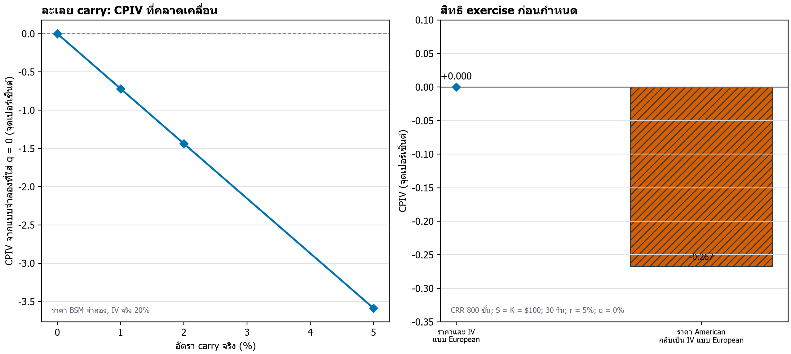
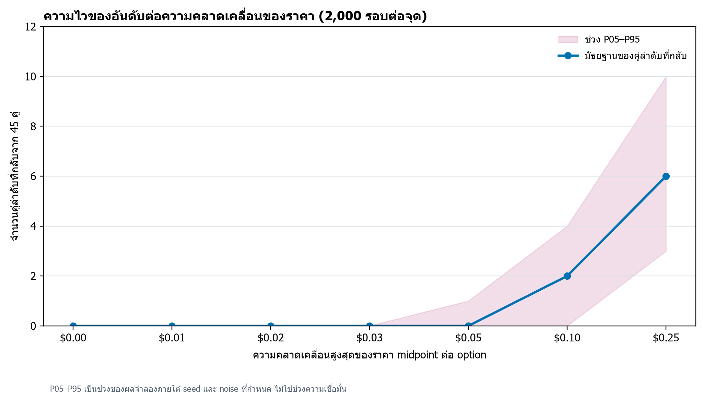

**ผู้เขียน:** Phirawit Jitnarong (พีรวิชญ์ จิตณรงค์) · Independent researcher  
[ORCID 0009-0006-8368-5309](https://orcid.org/0009-0006-8368-5309) · nxme176@gmail.com

**ปรับปรุง:** 8 ตุลาคม 2026 · วันที่ปรับปรุงต้นฉบับ ไม่ใช่วันเผยแพร่

## บทคัดย่อ

เมื่อ call และ put ของหุ้นตัวเดียวกันมีราคาใช้สิทธิและวันหมดอายุเดียวกัน แบบจำลอง European ภายใต้สมมติฐานเดียวกันชี้ให้เห็นความสัมพันธ์ put–call parity แต่ราคาในตลาดอาจเบี่ยงเบนจากแบบจำลอง และส่วนต่าง implied volatility ระหว่างสองฝั่งอาจสะท้อนทั้งข้อมูลและข้อจำกัดในการซื้อขาย บทความนี้นิยาม call–put implied volatility spread (CPIV) พร้อมแยกผลตอบแทนหุ้นออกจากผลตอบแทนของสัญญา options

งานวิจัยก่อนหน้ารายงานความสัมพันธ์ระหว่าง CPIV กับผลตอบแทนหุ้น และเสนอคำอธิบายที่เกี่ยวกับ jump risk, ข้อมูลจากตลาด options, ความต้องการซื้อขาย และข้อจำกัดการขายชอร์ต บทความนี้ทำให้ประเด็นเชิงปริมาณเห็นได้ชัดขึ้นด้วยการจำลองสามแบบ: ละเลย effective carry ทำให้เกิด CPIV เทียมได้ถึง −3.59 จุดเปอร์เซ็นต์ในชุดสมมติ; การกลับราคา American ด้วย European BSM-IV ให้ −0.267 จุดเปอร์เซ็นต์; และ quote noise ทำให้อันดับเริ่มคลาดเคลื่อนเมื่อขนาดความคลาดเคลื่อนเพิ่มขึ้น

**ขอบเขตหลักฐาน:** ตัวเลขและกราฟใหม่ทั้งหมดมาจากแบบจำลองกับการจำลองที่ระบุ seed และจำนวนรอบ ไม่มีราคา options หรือผลตอบแทนจากตลาดจริง ผลจำลองจึงใช้สอนเรื่องการวัดและความไว ไม่ใช่ค่าประมาณ alpha หรือผลการลงทุน

**คำสำคัญ:** implied volatility, CPIV, put–call parity, options, cross-sectional returns, model risk

## English abstract

For a call and put on the same stock with a common strike and expiration, a European pricing framework imposes put–call parity under shared assumptions. Observed prices may depart from that benchmark, and the resulting call–put implied-volatility spread (CPIV) can reflect information as well as trading frictions. This article defines CPIV and distinguishes underlying-stock returns from option-contract returns.

Prior studies report associations between CPIV and stock returns and discuss channels involving jump risk, information in options, trading demand, and short-sale constraints. Three reproducible synthetic exercises show how omitted effective carry can create a spread of −3.59 percentage points, how European BSM inversion of American-style prices can create a −0.267-point spread, and how increasing quote-price noise degrades a ten-name ranking. All prices and returns in these exercises are constructed; no historical options or stock data are used. The results teach measurement sensitivity and do not estimate alpha or investment performance.

## 1. ปริศนาที่ทำให้ CPIV น่าสนใจ

ถ้า call และ put ให้สิทธิในหุ้นตัวเดียวกัน ที่ราคาใช้สิทธิและวันหมดอายุเดียวกัน ทำไม implied volatility ของทั้งสองฝั่งจึงไม่เท่ากันเสมอ? ภายใต้ European options และสมมติฐานการเงินชุดเดียวกัน put–call parity เชื่อมราคาของทั้งคู่ไว้ แต่ quote ที่เห็นจริงอาจเบี่ยงเบนจากความสัมพันธ์นั้น ส่วนต่างที่วัดได้จึงเป็นร่องรอยที่ควรถามต่อว่าเกิดจากอะไร

Cremers และ Weinbaum (2010) รายงานว่าหุ้นที่ call มีราคาแพงสัมพัทธ์ให้ผลตอบแทนสูงกว่าหุ้นที่ put มีราคาแพงสัมพัทธ์ 50 basis points ต่อสัปดาห์ภายใต้แบบศึกษาเดิม งานเดียวกันยังรายงานว่าความสามารถในการทำนายลดลงตลอดช่วงตัวอย่าง ตัวเลขรายสัปดาห์นี้เป็นผลที่ผู้เขียนรายงานจากการศึกษานั้น ไม่ใช่ประมาณการของบทความนี้ ไม่ใช่ผลตอบแทนของสัญญา call และไม่ใช่ผลตอบแทนสุทธิที่คาดได้จากกลยุทธ์ใหม่

CPIV น่าสนใจเพราะส่วนต่างเดียวอาจพาดผ่านหลายกลไก:

1. **ข้อมูลและ jump risk:** Bali และ Hovakimian (2009) รายงานทั้งความสัมพันธ์ระหว่าง call–put IV spread กับผลตอบแทนหุ้น และข้อมูลที่ไหลจาก options รายตัวไปยังหุ้น โดยตีความ spread เป็น proxy ของ jump risk และรูปแบบข้อมูลสอดคล้องกับ informed trading
2. **พื้นฐานบริษัทกับ mispricing:** Doran, Fodor และ Jiang (2013) พบความสัมพันธ์เชิงบวกระหว่าง spread กับผลตอบแทนหุ้น แต่เชิงลบกับผลตอบแทน OTM call; หลักฐานปริมาณซื้อขายของพวกเขาชี้ว่าสเปรดมีข้อมูลทั้งด้าน fundamentals และการตั้งราคา options
3. **ข้อจำกัดการขายชอร์ต:** Ofek, Richardson และ Whitelaw (2004) รายงานว่าการเบี่ยงเบนจาก put–call parity ไม่สมมาตรตามข้อจำกัด short sale และสัมพันธ์กับต้นทุนหรือความยากในการยืมหุ้น ส่วน Cremers–Weinbaum รายงานว่าผลของตนไม่ได้อธิบายได้ด้วยหุ้นที่ยากต่อการยืมเพียงอย่างเดียว
4. **การวัดและสภาพคล่อง:** แบบจำลองที่ใส่เงินปันผลหรือ carry ไม่ครบ, quote ที่กว้าง, เวลาอ้างอิงไม่ตรง, และสิทธิ exercise ที่ต่างกัน ล้วนเปลี่ยน IV ที่คำนวณได้ กลไกเหล่านี้ไม่สามารถแยกจาก CPIV เพียงค่าเดียว

CPIV คำนวณจากราคา options ที่สังเกตได้ ไม่จำเป็นต้องมี census ของ positions หรือ open interest (OI) ทั้งตลาด การจำกัด universe ไว้ที่ options ที่มี quote สาธารณะทำให้วัดซ้ำได้ แต่ไม่ครอบคลุมสัญญา OTC ที่ไม่เปิดเผย และไม่ควรตีความเป็นตัวแทนของกิจกรรมทั้งหมดในตลาด

## 2. นิยามและมาตรวัดใกล้เคียง

สำหรับหุ้น \(i\) ณ เวลา \(t\) จับคู่ call และ put ที่มี underlying, strike \(K\), expiration \(T\), และ timestamp เดียวกัน นิยาม CPIV พื้นฐานเป็น

$$
CPIV_{i,t}(K,T)=IV^{call}_{i,t}(K,T)-IV^{put}_{i,t}(K,T).
$$

ค่า CPIV บวกหมายถึง IV ของ call สูงกว่า put ภายใต้นิยามและแบบจำลองเดียวกัน ความต่าง \(0.01\) ในหน่วยทศนิยมเท่ากับหนึ่งจุดเปอร์เซ็นต์ของ volatility ไม่ใช่ผลตอบแทนหนึ่งเปอร์เซ็นต์และไม่ใช่ส่วนต่างราคาโดยตรง

คำว่า “volatility spread” ในงานวิจัยไม่ได้รับประกันว่านิยามทุกชิ้นเหมือนกัน จึงควรแยกอย่างน้อยสามแนวคิด:

- **Volatility skew หรือ smirk** เปรียบเทียบ IV ระหว่าง strike หรือ delta ต่างกัน เช่น Xing, Zhang และ Zhao (2010) ศึกษารูปร่างของ individual-option smirk
- **Realized–implied volatility spread** เปรียบเทียบ volatility ที่เกิดขึ้นจริงกับ volatility จากราคา options งานของ Bali และ Hovakimian (2009) ศึกษามาตรวัดนี้ควบคู่กับ call–put IV spread ไม่ใช่ใช้แทนกัน
- **ผลตอบแทนของ option contract** ขึ้นกับราคา option, delta, theta, vega, gamma, hedge และอายุสัญญา จึงไม่เท่ากับผลตอบแทนของหุ้นที่ CPIV อาจใช้จัดอันดับ

## 3. จากราคา options สู่ implied volatility

ตัวอย่าง European ใช้ Black–Scholes–Merton (BSM) เพื่อให้เห็นขั้นตอนอย่างโปร่งใส กำหนด spot \(S\), strike \(K\), อายุ \(T\) ปี, อัตราดอกเบี้ย \(r\), continuous effective yield \(q\), และ volatility \(\sigma\):

$$
d_1=\frac{\ln(S/K)+(r-q+\sigma^2/2)T}{\sigma\sqrt{T}},
\qquad d_2=d_1-\sigma\sqrt{T},
$$

$$
C=Se^{-qT}N(d_1)-Ke^{-rT}N(d_2),
\qquad
P=Ke^{-rT}N(-d_2)-Se^{-qT}N(-d_1).
$$

ในสมการ \(N(\cdot)\) คือ cumulative distribution function ของ standard normal การหา IV ย้อนกลับคือหาค่า \(\sigma\) ที่ทำให้ราคาจากแบบจำลองเท่ากับราคา input โค้ดตัวอย่างใช้ bisection บนช่วง \([10^{-8},5]\) และตรวจ price bounds ก่อนเริ่มแก้สมการ

สำหรับ European call และ put ที่จับคู่กัน parity เขียนได้ว่า

$$
C-P=Se^{-qT}-Ke^{-rT}.
$$

เมื่อราคาและสมมติฐานสอดคล้องกับ parity การกลับราคาด้วยแบบจำลองเดียวกันให้ IV ที่สอดคล้องกัน ความเบี่ยงเบนของ quote จริงจึงอาจสะท้อนข้อมูล ความต้องการซื้อขาย หรือข้อจำกัด arbitrage ได้ แต่ไม่ใช่หลักฐาน arbitrage โดยตัวมันเอง

ออปชันหุ้นสหรัฐฯ โดยทั่วไปเป็น American-style ตามข้อกำหนดผลิตภัณฑ์ของ OCC; BSM ในตัวอย่างจึงเป็น European benchmark ไม่ใช่คำอธิบายครบถ้วนของราคา options เหล่านั้น การ exercise ก่อนกำหนดมีความสำคัญโดยเฉพาะเมื่อเงินปันผลหรือสถานะของสัญญาทำให้การ exercise มีมูลค่า ในงานจริงควรใช้ pricer ที่สอดคล้องกับสิทธิของสัญญา หรือระบุให้ชัดว่า BSM-IV เป็น proxy และวิเคราะห์ความไว

## 4. ตัวอย่างจำลอง: ความคลาดเคลื่อนของแบบจำลองสร้าง spread ได้

ทุกกรณีในส่วนนี้ใช้ \(S=K=\$100\), อายุ 30 วัน และ volatility จริง 20% เว้นแต่ระบุเป็นอย่างอื่น ตัวเลขต่อไปนี้คำนวณซ้ำได้จากสคริปต์ที่มากับชุดเอกสาร

### 4.1 ละเลย effective carry

สร้างราคา European BSM ด้วยอัตรา \(q\) จริง แต่ผู้วิเคราะห์กลับราคาโดยกำหนด \(q=0\) ทั้งสองขามี volatility จริง 20% และ \(r=0\) ตารางแสดง CPIV ที่เกิดจากการใส่ carry ไม่ครบ:

| \(q\) จริง | \(q\) ที่ใช้กลับ | Call IV | Put IV | CPIV เทียม (pp) |
|---:|---:|---:|---:|---:|
| 0% | 0% | 20.000% | 20.000% | 0.000 pp |
| 1% | 0% | 19.635% | 20.353% | −0.719 pp |
| 2% | 0% | 19.273% | 20.710% | −1.437 pp |
| 5% | 0% | 18.217% | 21.804% | −3.587 pp |

นี่เป็นการทดลองกับ continuous yield ในแบบจำลอง ไม่ใช่การประมาณ stock-borrow fee จริง ประเด็นคือความผิดพลาดร่วมของสมมติฐานสามารถสร้างส่วนต่างขนาดใกล้เคียงกับ CPIV ที่นักวิจัยอาจนำไปตีความเป็นสัญญาณได้

### 4.2 ราคา American แต่กลับค่าเป็น European IV

สร้างราคา American ด้วยต้นไม้ Cox–Ross–Rubinstein (CRR) 800 ขั้น, \(r=5\%\), \(q=0\%\), อายุ 30 วัน และ \(\sigma=20\%\) จากนั้นใช้ European BSM กลับราคา:

| วิธีสร้างราคา | Call IV (BSM) | Put IV (BSM) | CPIV |
|---|---:|---:|---:|
| European BSM | 20.000% | 20.000% | 0.000 pp |
| American CRR | 19.994% | 20.261% | −0.267 pp |

เมื่อ \(q=0\) call แบบ American ไม่มีแรงจูงใจจากเงินปันผลให้ exercise ก่อนกำหนด แต่ put อาจมี early-exercise value; เมื่อนำราคาทั้งคู่ไปตีความด้วย European model ค่า IV ที่ได้จึงแยกออกจากกัน รูปที่ 1 เปรียบเทียบกรณีนี้กับการละเลย carry

## 5. Quote noise เปลี่ยนอันดับได้แค่ไหน?

เพื่อให้การจำลองมีงานมากกว่าการคำนวณ IV กลับไปเป็น input เดิม กำหนดคู่สัญญาสังเคราะห์ 10 คู่ให้ put IV เท่ากับ 20% และ call IV ตั้งแต่ 16% ถึง 25% ทีละหนึ่งจุดเปอร์เซ็นต์ สร้างราคา midpoint ด้วย BSM แล้วเติม price noise อิสระแบบ uniform \([-h,+h]\) ให้ call และ put ของแต่ละคู่ จากนั้นคำนวณ CPIV และจัดอันดับใหม่

แต่ละค่า \(h\) ใช้ 2,000 รอบและ seed 20261008 ตัวชี้วัดคือจำนวนคู่ลำดับที่กลับจาก 45 คู่ทั้งหมด และ Spearman rank correlation เทียบกับลำดับที่ใช้สร้างข้อมูล:

| half-spread สมมติ \(h\) ต่อ option | คู่ลำดับที่กลับ: มัธยฐาน [P05, P95] | Spearman \(\rho\): มัธยฐาน [P05, P95] |
|---:|---:|---:|
| $0.00 | 0 [0, 0] | 1.00 [1.00, 1.00] |
| $0.01 | 0 [0, 0] | 1.00 [1.00, 1.00] |
| $0.02 | 0 [0, 0] | 1.00 [1.00, 1.00] |
| $0.03 | 0 [0, 0] | 1.00 [1.00, 1.00] |
| $0.05 | 0 [0, 1] | 1.00 [0.99, 1.00] |
| $0.10 | 2 [0, 4] | 0.98 [0.95, 1.00] |
| $0.25 | 6 [3, 10] | 0.87 [0.72, 0.96] |

รูปที่ 2 แสดงการกระจายของจำนวนคู่ที่กลับในแต่ละระดับ noise ช่วง P05–P95 เป็น quantile จากการจำลองที่กำหนด ไม่ใช่ confidence interval และ \(h\) เป็นขนาด perturbation ของ midpoint ที่สมมติขึ้น ไม่ใช่ค่าประมาณ bid–ask ของตลาดจริง

<!-- CPIV_INTERACTIVE_WIDGET -->

ภายใต้ชุดจำลองนี้อันดับยังคงตรงในเกือบทุกรอบที่ \(h\leq\$0.03\), แต่ที่ \(h=\$0.25\) มัธยฐานมีคู่ลำดับกลับ 6 จาก 45 คู่ ผลดังกล่าวไม่ใช่เส้นแบ่งสภาพคล่องสากล: ระยะห่างของ CPIV ที่ป้อน, distribution ของความคลาดเคลื่อน, skew ของ quote และ model error ล้วนเปลี่ยนข้อสรุปได้ ตัวอย่างนี้ชี้เหตุผลว่าทำไมงานจริงต้องรายงาน quote quality และทดสอบอันดับภายใต้ perturbation ที่ผูกกับข้อมูลจริง

## 6. งานวิจัยเดิม: สัญญาณเดียว หลายผลลัพธ์

Bali และ Hovakimian (2009) ศึกษาทั้ง realized–implied volatility spread และ call–put IV spread พวกเขารายงานความสัมพันธ์เชิงลบระหว่าง realized–implied spread กับผลตอบแทนหุ้น และความสัมพันธ์เชิงบวกระหว่าง expected returns กับ call–put IV spread โดยมองอย่างหลังเป็น proxy ของ jump risk บทคัดย่อยังรายงาน information flow จาก equity options รายตัวไปยังหุ้น นี่เป็นเหตุผลสำคัญที่งานนี้ควรปรากฏในวรรณกรรม CPIV ไม่ใช่ถูกจัดเป็นตัวอย่างของมาตรวัดที่ไม่ใช่ CPIV

Cremers และ Weinbaum (2010) ใช้ call–put IV differences วัด deviation จาก put–call parity รายงานผลต่างผลตอบแทน 50 basis points ต่อสัปดาห์ และพบว่าความสามารถในการทำนายลดลงตลอดช่วงตัวอย่าง Doran, Fodor และ Jiang (2013) ขยายความต่างระหว่างสินทรัพย์: volatility spread สัมพันธ์เชิงบวกกับผลตอบแทนหุ้น แต่เชิงลบกับผลตอบแทน OTM call; ผู้เขียนสรุปว่าสเปรดมีข้อมูลเกี่ยวกับทั้ง fundamentals ของบริษัทและ option mispricing

ผลในอดีตควรอ่านเป็นหลักฐานในแบบศึกษาและ sample ของแต่ละงาน ไม่ใช่ผล backtest ปัจจุบัน McLean และ Pontiff (2016) ศึกษาตัวทำนายผลตอบแทนหุ้น 97 ตัวโดยรวม และรายงานว่าผลตอบแทนพอร์ตต่ำลง 26% นอกตัวอย่างและ 58% หลังตีพิมพ์ ตัวเลขรวมนี้ไม่ใช่ค่าประมาณการเสื่อมของ CPIV โดยเฉพาะ แต่เตือนว่าการทดสอบใหม่ต้องกันช่วงเวลาที่ไม่ถูกใช้เลือกโมเดล

ต้นทุนก็ไม่ควรถูกลดเหลือการหักครึ่ง bid–ask แบบกลไก Muravyev และ Pearson (2020) ศึกษาความสามารถในการจับจังหวะการส่งคำสั่งในตลาด options และชี้ว่าข้อสรุปเรื่อง after-cost profitability เปลี่ยนได้เมื่อคำนึงถึงวิธี execution การทดสอบ CPIV จึงควรรายงาน quote, spread, slippage, turnover และต้นทุนหุ้น/การยืมหุ้นตามสินทรัพย์ที่กลยุทธ์ซื้อขายจริง

## 7. ขั้นตอนทดสอบด้วยข้อมูลจริง

ส่วนนี้เป็นแผนการศึกษาที่เสนอไว้สำหรับงานต่อไป ไม่ใช่ protocol ที่ฝากทะเบียนไว้หรือผล holdout ที่เก็บแล้ว

### 7.1 ตรึง universe และ snapshot

กำหนดรายชื่อหุ้นและวิธีจัดการ delisted securities, เกณฑ์ราคา/สภาพคล่อง, เวลา snapshot, timezone, วันหยุด, DTE, moneyness และกฎจับคู่ call–put ก่อนคำนวณผลตอบแทน บันทึกจำนวนคู่ที่เข้าถึงได้และจำนวนที่ถูกตัดจาก quote filter รวมถึงขอบเขตของ listed options ที่ข้อมูลครอบคลุม

### 7.2 ตรึงการวัดและพอร์ต

ระบุแบบจำลอง IV, curve ของอัตราดอกเบี้ย, เงินปันผล/carry, วิธีจัดการ American exercise, zero bid, crossed/stale quotes และการเลือกคู่เมื่อมีหลายสัญญา หากทดสอบ replication ให้ทำตามนิยามต้นฉบับก่อนแยกการทดลองปรับนิยาม กำหนดการรวมสัญญาณ, rebalance, น้ำหนัก, benchmark และ horizon ก่อนดูผล

### 7.3 แยกผลตอบแทนและต้นทุน

หากพอร์ตซื้อขายหุ้น ให้รายงานผลตอบแทนหุ้นหลัง transaction costs, short-borrow fees และข้อจำกัดการขายชอร์ต หากซื้อขาย option contracts ให้ใช้ bid/ask หรือแบบจำลอง execution ที่ระบุชัดและรวม hedge costs ผลต้องแยก gross ออกจาก net พร้อม turnover, drawdown, exposures, จำนวนหุ้น/วัน และความไม่แน่นอนของค่าประมาณ

### 7.4 กัน holdout และ multiple testing

แบ่ง development, validation และ holdout ตามลำดับเวลา ตรึง code, signal, quote filters, costs และ benchmark ก่อนเปิด holdout บันทึก protocol พร้อม timestamp ที่ตรวจสอบได้ ถ้ามีการเปลี่ยนกฎหลังเห็นผล ให้จัดผลนั้นเป็น exploratory และกันช่วง holdout ใหม่ การทดลองหลาย DTE, cutoff, weighting หรือ rebalance ต้องบันทึกทั้งหมดและใช้เกณฑ์ inference ที่คำนึงถึง multiple testing (Harvey, Liu, & Zhu, 2016)

### 7.5 ตรวจสิทธิ์และการทำซ้ำ

ตรวจสิทธิ์ดึง เก็บ แปรรูป และเผยแพร่ข้อมูลแยกจากการที่หน้าเว็บเปิดดูได้ ระบุผู้ให้บริการ, endpoint, timestamp semantics, ข้อจำกัด redistribution และวิธีทำซ้ำก่อนเริ่มศึกษา ราคาที่เปิดดูได้ไม่ยืนยันว่ามี historical option chain ครบหรือมีสิทธิ์เผยแพร่ต่อ

## 8. ข้อจำกัดและข้อสรุป

ผลเชิงปริมาณในบทความนี้ขึ้นกับสัญญาสังเคราะห์สิบคู่, BSM parameters, noise แบบ uniform, seed และ 2,000 รอบต่อระดับ \(h\) carry example ใช้ continuous effective yield ไม่ได้แยก borrow fee จริง ส่วน American test ใช้ CRR grid 800 ขั้นและกลับค่าด้วย European BSM; จึงสาธิต model mismatch ในกรณีควบคุม ไม่ได้วัดขนาดปัญหาใน quote ตลาด

วรรณกรรมที่ทบทวนชี้ว่าราคา call–put อาจรวบรวมข้อมูลเกี่ยวกับ jump risk, ข้อมูลบริษัท, demand และข้อจำกัด arbitrage ได้พร้อมกัน แต่ spread ค่าเดียวไม่ระบุกลไกต้นเหตุโดยลำพัง การจำกัดข้อมูลไว้ที่ listed quotes ยังเว้นสัญญา OTC ที่ไม่เปิดเผยไว้ภายนอก estimand นี้

บทเรียนเชิงปริมาณคือ CPIV ต้องอ่านควบคู่กับแบบจำลอง carry, สิทธิ exercise, คุณภาพ quote และนิยามผลตอบแทน งานเดิมให้สมมติฐานที่น่าสนใจ ส่วนการจำลองแสดงจุดที่การวัดอาจคลาดเคลื่อน ขั้นต่อไปที่ชี้ขาดได้คือทดสอบ signal บน historical option-chain data ที่มีสิทธิ์ใช้ โดยตรึงกฎและ holdout ล่วงหน้า แล้วรายงานผลสุทธิภายใต้ต้นทุนที่ตรวจสอบได้

## การเปิดเผยและวัสดุประกอบ

ผู้เขียนรายงานว่าไม่มีแหล่งทุนภายนอกและไม่มีผลประโยชน์ทับซ้อนที่เกี่ยวข้องกับบทความนี้ กราฟและตารางจำลองสร้างด้วย Python จาก research/cpiv/build_demo.py เมื่อ 8 ตุลาคม 2026; seed และผล machine-readable อยู่ในแฟ้มประกอบชุดเดียวกัน แฟ้มเหล่านี้ยังไม่ได้เผยแพร่บน GitHub หรือ Zenodo

## การทำซ้ำ

สคริปต์, ชุดทดสอบ, CSV/JSON และไฟล์ภาพส่งมาพร้อมกับชุดต้นฉบับเพื่อให้ตรวจสอบและรันซ้ำได้ในเครื่อง โค้ดสร้างการจำลองโดยไม่เรียก API หรือดาวน์โหลดข้อมูลตลาด การเผยแพร่ repository สาธารณะยังเป็นขั้นตอนแยกต่างหาก

\newpage

## References

Bali, T. G., & Hovakimian, A. (2009). Volatility spreads and expected stock returns. *Management Science, 55*(11), 1797–1812. <https://doi.org/10.1287/mnsc.1090.1063>

Black, F., & Scholes, M. (1973). The pricing of options and corporate liabilities. *Journal of Political Economy, 81*(3), 637–654. <https://doi.org/10.1086/260062>

Cox, J. C., Ross, S. A., & Rubinstein, M. (1979). Option pricing: A simplified approach. *Journal of Financial Economics, 7*(3), 229–263. <https://doi.org/10.1016/0304-405X(79)90015-1>

Cremers, M., & Weinbaum, D. (2010). Deviations from put-call parity and stock return predictability. *Journal of Financial and Quantitative Analysis, 45*(2), 335–367. <https://doi.org/10.1017/S002210901000013X>

Doran, J. S., Fodor, A., & Jiang, D. (2013). Call-put implied volatility spreads and option returns. *The Review of Asset Pricing Studies, 3*(2), 258–290. <https://doi.org/10.1093/rapstu/rat006>

Harvey, C. R., Liu, Y., & Zhu, H. (2016). … and the cross-section of expected returns. *The Review of Financial Studies, 29*(1), 5–68. <https://doi.org/10.1093/rfs/hhv059>

McLean, R. D., & Pontiff, J. (2016). Does academic research destroy stock return predictability? *The Journal of Finance, 71*(1), 5–32. <https://doi.org/10.1111/jofi.12365>

Muravyev, D., & Pearson, N. D. (2020). Options trading costs are lower than you think. *The Review of Financial Studies, 33*(11), 4973–5014. <https://doi.org/10.1093/rfs/hhaa010>

Ofek, E., Richardson, M., & Whitelaw, R. F. (2004). Limited arbitrage and short sales restrictions: Evidence from the options markets. *Journal of Financial Economics, 74*(2), 305–342. <https://doi.org/10.1016/j.jfineco.2003.05.008>

Options Clearing Corporation. (n.d.). *Equity options: Product specifications*. Retrieved October 8, 2026, from <https://www.theocc.com/clearance-and-settlement/clearing/equity-options-product-specifications>

Xing, Y., Zhang, X., & Zhao, R. (2010). What does the individual option volatility smirk tell us about future equity returns? *Journal of Financial and Quantitative Analysis, 45*(3), 641–662. <https://doi.org/10.1017/S0022109010000220>
