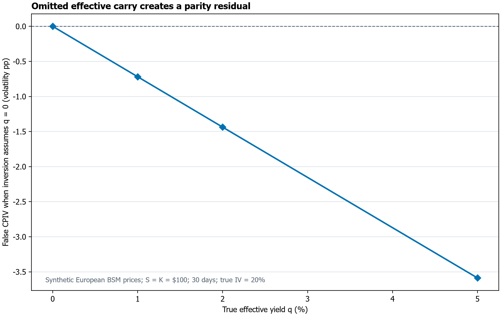
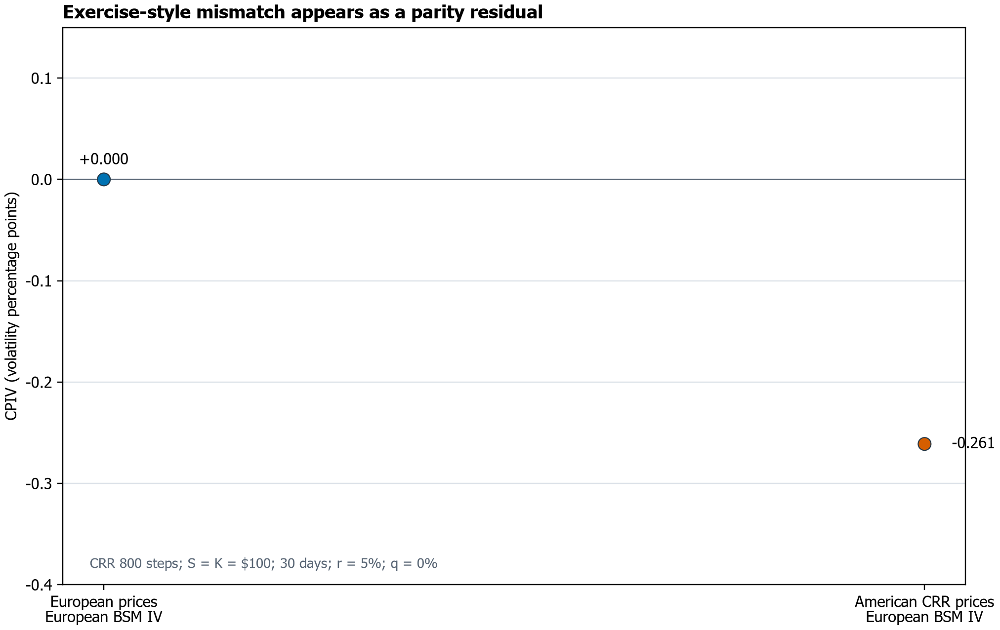
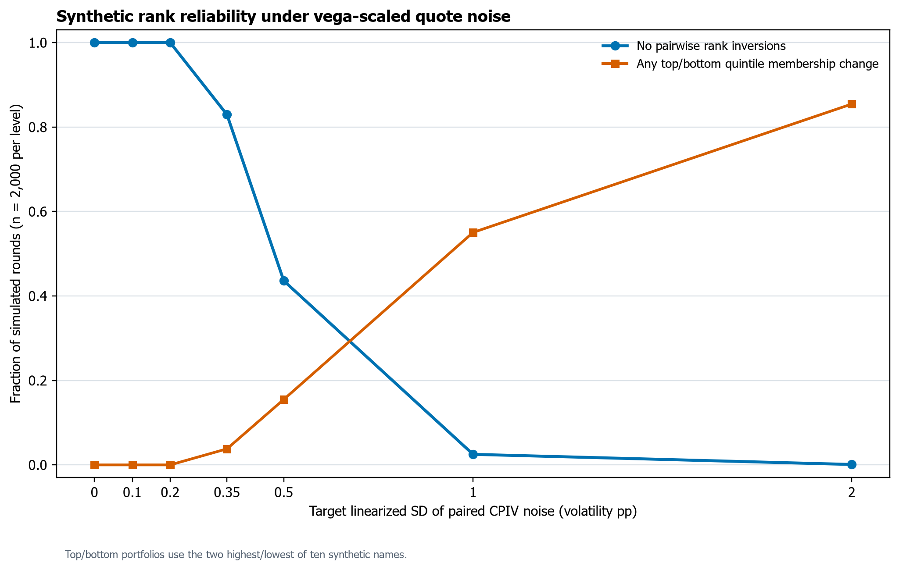

**Independent researcher**  
[ORCID 0009-0006-8368-5309](https://orcid.org/0009-0006-8368-5309) · [email removed]

## สรุปย่อ {#quick-summary}

- CPIV คือส่วนต่าง implied volatility ระหว่าง call กับ put ที่จับคู่สัญญาและเวลาเดียวกัน ไม่ใช่ผลตอบแทนของกลยุทธ์
- ภายใต้ European BSM ส่วนต่างนี้ประมาณ put–call-parity residual หารด้วย vega; carry, early exercise, spot timestamp ที่ไม่ตรง และ quote noise จึงอาจสร้าง wedge ได้
- การทดลองในบทความเป็นข้อมูลสังเคราะห์ทั้งหมด: ไม่มี option-chain, stock return หรือผลกลยุทธ์จากตลาดจริง
- ข้อสรุปที่รองรับคือ CPIV ต้องผ่านการตรวจสมมติฐานและคุณภาพข้อมูลก่อนตีความ ไม่ใช่ข้ออ้างว่า CPIV เป็น alpha หรือเกิด arbitrage

## บทคัดย่อ {#abstract-th}

Call–put implied volatility spread (CPIV) มักถูกอ่านเป็นข้อมูลเกี่ยวกับความเสี่ยงหรือความต้องการซื้อขาย แต่ส่วนต่างนี้ยังเป็นการแปลงราคาของ call และ put ผ่านแบบจำลอง implied volatility บทความนี้เชื่อม CPIV กับ put–call-parity residual ผ่าน vega โดยแสดงว่าภายใต้ European Black–Scholes–Merton (BSM) และรอบจุดอ้างอิงเดียวกัน \(CPIV_{\mathrm{pp}}\approx100R/\nu\) เมื่อ \(R=C-P-(Se^{-qT}-Ke^{-rT})\) และ \(\nu\) คือ vega ต่อ volatility หน่วยทศนิยม

การทดลองเชิงสังเคราะห์แสดง wedge จาก carry ที่ละเลย, early-exercise premium ของ American put, spot ที่อ้างอิงคนละเวลา และ quote-price noise ที่ปรับสเกลด้วย vega บทความยังแสดงว่าความคลาดเคลื่อนของราคาเท่ากันในหน่วยดอลลาร์ไม่ได้มีผลเป็น volatility points เท่ากันเมื่อ spot หรืออายุสัญญาเปลี่ยน ข้อมูลทั้งหมดสร้างจากแบบจำลองและ seed ที่ระบุ ไม่มีข้อมูลตลาดจริง ไม่มีการประมาณผลตอบแทนหรือ alpha และไม่มีข้อสรุปเชิงลงทุน

**คำสำคัญ:** call–put implied volatility spread, put–call parity, vega, implied volatility, quote quality, model risk

## English abstract {#abstract-en}

The call–put implied-volatility spread (CPIV) is often interpreted as information about risk or trading demand, but it is also a transformation of paired option prices through an implied-volatility model. This article links CPIV to the put–call-parity residual through vega. Under a European Black–Scholes–Merton benchmark and a common local reference volatility, \(CPIV_{\mathrm{pp}}\approx100R/\nu\), where \(R=C-P-(Se^{-qT}-Ke^{-rT})\) and \(\nu\) is vega per unit decimal volatility.

Synthetic experiments illustrate wedges caused by omitted carry, an American put’s early-exercise premium, a spot timestamp mismatch, and vega-scaled quote noise. They also show why an equal dollar quote error does not imply an equal volatility-point error across spot prices or maturities. All prices and rankings are constructed from a stated model and seed; no historical options, stock returns, alpha estimates, or investment results are used.

## 1. คำถามที่อยู่หลังส่วนต่าง {#sec-motivation}

เหตุใด call และ put ที่มี underlying, strike และวันหมดอายุเดียวกันจึงอาจให้ implied volatility ต่างกัน? ภายใต้ European pricing และสมมติฐานเดียวกัน put–call parity เชื่อมราคาทั้งสองไว้ แต่ CPIV ที่คำนวณจาก quote อาจรวมทั้งข้อมูลทางเศรษฐกิจและความคลาดเคลื่อนจากการวัด คำถามสำคัญจึงไม่ใช่แค่ว่า wedge เป็นบวกหรือลบ แต่คือ residual ใดถูกแปลงเป็น volatility และ residual นั้นมาจากอะไร

CPIV อาจสะท้อนทั้งข้อมูลทางเศรษฐกิจและ measurement error; ผลตอบแทนหุ้นที่งานเดิมศึกษาไม่ใช่ผลตอบแทนของ option contract และไม่ใช่ผลการลงทุนที่บทความนี้จำลองหรือยืนยัน

ความต่างนี้ทำให้การวัดสำคัญ: Cremers และ Weinbaum รายงานส่วนต่างผลตอบแทนหุ้น 50 basis points ต่อสัปดาห์ใน specification ของตน ขณะที่การทดลองสังเคราะห์ที่ละเลย effective yield 5% ให้ CPIV เทียม −3.587 volatility points ในกรณี ATM 30 วัน ตัวเลขสองชุดนี้เป็นคนละ outcome และคนละหน่วย จึงห้ามตีความว่าอันหนึ่งใหญ่กว่าหรือหักล้างอีกอัน; จุดประสงค์ของการวางไว้ใกล้กันคือเตือนว่า measurement wedge อาจบดบังการตีความเชิงเศรษฐกิจได้

บทความนี้ไม่ได้เสนอโมเดล alpha ใหม่หรืออ้างความใหม่ของความสัมพันธ์เชิงพยากรณ์ ผลงานที่ทำคือ (1) แสดง local mapping จาก parity residual ไปยัง CPIV, (2) ตรวจซ้ำได้ว่ากลไกจากการตั้งสมมติฐานและเวลาอ้างอิงสร้าง wedge ขนาดใดในสถานการณ์ที่กำหนด และ (3) ปรับ quote-noise experiment ให้อยู่ในหน่วย volatility points พร้อมเมตริกความผิดพลาดของอันดับที่เกี่ยวกับการเลือก long/short quintile ทั้งหมดเป็น sensitivity analysis ไม่ใช่การวัดขนาดปัญหาในตลาดจริง

CPIV สร้างได้จาก option quotes ที่มีสิทธิ์ใช้และไม่ได้ต้องอาศัย census ของ positions หรือ open interest ทั้งตลาด แต่ estimand จะครอบคลุมเพียงสัญญาและตลาดที่แหล่งข้อมูลเข้าถึงได้ ไม่ครอบคลุม OTC ที่ไม่เปิดเผยโดยอัตโนมัติ

## 2. นิยามและสิ่งที่ไม่ควรปะปน {#sec-definition}

สำหรับ underlying \(i\) ณ เวลา \(t\) จับคู่ call และ put ที่มี strike \(K\), expiration \(T\), สิทธิ exercise และ timestamp ที่สอดคล้องกัน นิยามพื้นฐานคือ

$$
CPIV_{i,t}(K,T)=IV^{call}_{i,t}(K,T)-IV^{put}_{i,t}(K,T).
$$

ค่าบวกหมายถึง call IV สูงกว่า put IV ภายใต้นิยามและแบบจำลองเดียวกัน หนึ่ง volatility point คือความต่าง 0.01 ในหน่วย volatility ทศนิยม เช่น 20.00% กับ 20.25% ต่างกัน 0.25 จุดเปอร์เซ็นต์ของ volatility ไม่ใช่ผลตอบแทน 0.25% และไม่ใช่ส่วนต่างราคา

ต้องแยกตัวแปรสามชนิด:

- **CPIV:** เปรียบเทียบ call กับ put ซึ่งจับคู่ strike/expiration เดียวกัน
- **Volatility smirk/skew:** เปรียบเทียบ IV ข้าม strike หรือ delta; เป็นรูปร่างของผิว IV ไม่ใช่ CPIV โดยนิยาม
- **Realized–implied volatility spread:** เปรียบเทียบ realized volatility กับ implied volatility; เป็นคนละ spread กับ CPIV

**ผลตอบแทนของ option contract เป็น outcome ไม่ใช่มาตรวัด volatility spread** เพราะขึ้นกับ option premium, delta, theta, vega, gamma, hedge และอายุสัญญา การที่ CPIV จัดอันดับหุ้นได้จึงไม่บอกโดยตรงว่าการซื้อขาย call/put ตามอันดับนั้นจะได้ผลตอบแทนเท่าใด

## 3. Put–call-parity residual ผ่าน vega {#sec-residual-bridge}

ใช้ European BSM เป็น benchmark เพื่อให้การแปลงโปร่งใส กำหนด spot \(S\), strike \(K\), อายุ \(T=D/365\) ปี, flat continuously-compounded rate \(r\), effective continuous yield \(q\), และ volatility \(\sigma\) โดย \(\sigma\) เป็นหน่วยทศนิยม:

$$
d_1=\frac{\ln(S/K)+(r-q+\sigma^2/2)T}{\sigma\sqrt{T}},
\qquad d_2=d_1-\sigma\sqrt{T}.
$$

$$
C=Se^{-qT}N(d_1)-Ke^{-rT}N(d_2),\qquad
P=Ke^{-rT}N(-d_2)-Se^{-qT}N(-d_1).
$$

ภายใต้ European BSM ที่จับคู่กัน \(C-P=Se^{-qT}-Ke^{-rT}\) (Black & Scholes, 1973; Merton, 1973) นิยาม residual ที่ใช้ในบทความเป็น

$$
R=C_{\mathrm{mkt}}-P_{\mathrm{mkt}}-\left(Se^{-qT}-Ke^{-rT}\right).
$$

เมื่อ call และ put ถูกประเมินใกล้ volatility อ้างอิงเดียวกัน \(\sigma_0\), vega ของทั้งสองขาเท่ากัน:

$$
\nu=\frac{\partial C}{\partial \sigma}
=\frac{\partial P}{\partial \sigma}
=Se^{-qT}\phi(d_1)\sqrt{T}.
$$

Taylor expansion รอบ \(\sigma_0\) ให้ \(R\approx\nu(IV^{call}-IV^{put})\) ดังนั้น

$$
CPIV_{\mathrm{decimal}}\approx\frac{R}{\nu},
\qquad
CPIV_{\mathrm{pp}}\approx\frac{100R}{\nu}
=\frac{R}{\nu_{\mathrm{pp}}},
\qquad \nu_{\mathrm{pp}}=\frac{\nu}{100}.
$$

หน่วยจึงตรงกัน: \(R\) เป็นดอลลาร์ต่อหุ้น, \(\nu\) เป็นดอลลาร์ต่อการเปลี่ยน \(\sigma\) หนึ่งหน่วยทศนิยม และ \(\nu_{\mathrm{pp}}\) เป็นดอลลาร์ต่อหนึ่ง volatility point ความสัมพันธ์นี้เป็นการประมาณเฉพาะที่ ไม่ใช่สมการ exact เมื่อ call/put IV ห่างกันมาก, vega ต่ำ, หรือแบบจำลอง/สิทธิของสัญญาไม่ตรงกัน ค่า exact ในการทดลองคำนวณด้วยการแก้ implied volatility แยกแต่ละขา

residual เดียวกันอาจมาจากหลายช่องทาง:

| แหล่ง residual | รูปของ \(R\) โดยประมาณ | สิ่งที่ต้องตรวจ |
|---|---|---|
| ใช้ effective carry ผิด | \(S(e^{-q_{\mathrm{true}}T}-e^{-q_{\mathrm{used}}T})\) | เงินปันผล, financing/borrow convention และ forward ที่ใช้ |
| American exercise | \(EEP_{call}-EEP_{put}\) เมื่อเทียบกับ European parity | exercise style, เงินปันผลและ early-exercise value |
| ความคลาดเคลื่อนของ quote | \(\epsilon_C-\epsilon_P\) | bid/ask, stale/crossed quote และความสัมพันธ์ของ noise สองขา |
| spot กับ option คนละเวลา | \((S_{\mathrm{quote}}-S_{\mathrm{used}})e^{-qT}\) ในกรณีจำลอง | timestamp, venue/clock และ spot/forward ที่จับคู่ |

ถ้า \(q\) แทน continuous effective yield ในการจำลอง มันไม่ใช่ค่าประมาณ stock-borrow fee หรือค่าใช้จ่ายยืมหุ้นจริง การใช้ parity-implied forward \(F^{parity}=K+e^{rT}(C-P)\) เทียบกับ forward/spot ที่ timestamp ตรงกันช่วยเป็น diagnostic ได้ แต่ไม่ได้ลบ bid–ask, exercise หรือข้อจำกัด arbitrage ออกไป CPIV ที่ไม่เป็นศูนย์จึงไม่ใช่หลักฐาน arbitrage ด้วยตัวมันเอง

## 4. Stress tests สังเคราะห์ {#sec-synthetic-tests}

ยกเว้นที่ระบุเป็นอย่างอื่น การทดลองใช้ \(S=K=\$100\), volatility จริง 20%, \(T=D/365\), \(r=0\), และใช้ BSM สร้างราคา ไม่มีการดึงราคา options, stock returns หรือข้อมูลตลาดใด ๆ อัตรา \(q\) ที่ทดลองเป็นพารามิเตอร์สมมติ ไม่ใช่สถิติจากหลักทรัพย์

### 4.1 ละเลย carry และผลของอายุสัญญา {#sec-carry}

สร้าง European BSM call/put ด้วย \(q_{\mathrm{true}}\), แล้วกลับราคาโดยตั้ง \(q_{\mathrm{used}}=0\) ทั้งที่ \(q_{\mathrm{true}}>0\). ตารางเป็นผล exact จาก IV inversion; \(R\) ใช้ parity ภายใต้สมมติฐาน \(q_{\mathrm{used}}=0\).

| \(q_{\mathrm{true}}\) | \(R\) (ดอลลาร์/หุ้น) | CPIV เทียม |
|---:|---:|---:|
| 0% | $0.000 | 0.000 pp |
| 1% | −$0.082 | −0.719 pp |
| 2% | −$0.164 | −1.437 pp |
| 5% | −$0.410 | −3.587 pp |



อายุสัญญาทำให้ noise และ carry มีแนวโน้มสวนทางกันภายใต้เงื่อนไขที่ตรึงไว้ ตารางต่อไปใช้ \(S=K=\$100\), quote-price error อิสระ \(U[-\$0.05,+\$0.05]\) ต่อขา และกรณีละเลย effective yield จริง 1%. คอลัมน์ noise คือส่วนเบี่ยงเบนมาตรฐานเชิงเส้นของ paired CPIV error; carry คือ exact CPIV จากการกลับราคา

| DTE | CPIV-noise SD จาก \(h=\$0.05\) | CPIV จากละเลย \(q=1\%\) |
|---:|---:|---:|
| 7 | 0.739 pp | −0.347 pp |
| 30 | 0.357 pp | −0.719 pp |
| 90 | 0.206 pp | −1.245 pp |
| 365 | 0.103 pp | −2.507 pp |

นี่เป็น trade-off ของชุดพารามิเตอร์ ไม่ได้ระบุ DTE ที่เหมาะที่สุด: vega ที่ต่ำลงในระยะสั้นขยายผลของ quote error หน่วยดอลลาร์ ขณะที่ carry residual สะสมตาม \(T\). ในงานจริงต้องประเมิน quote width, carry และ vega จากสัญญา/ตลาดเดียวกันก่อนเลือก maturity; ค่า 1% ที่นี่เป็น stress input ไม่ใช่ค่าธรรมเนียมการยืมหุ้น

ผลของ fixed-dollar noise ยังขึ้นกับระดับ spot ตารางย่อแสดง “SD จาก \(h=\$0.05\) ต่อขา / half-width ต่อขาที่เทียบเท่าเป้าหมาย paired CPIV SD = 0.5 pp” โดย \(S=K\), \(r=q=0\), \(\sigma=20\%\). ค่า half-width ใช้ \(h=0.5\nu_{\mathrm{pp}}\sqrt{3/2}\), เมื่อ errors ของ call/put เป็นอิสระและ uniform.

| DTE | \(S=K=\$20\) | \(S=K=\$100\) | \(S=K=\$500\) |
|---:|---:|---:|---:|
| 7 | 3.70 pp / $0.0068 | 0.74 pp / $0.0338 | 0.15 pp / $0.1691 |
| 30 | 1.79 pp / $0.0140 | 0.36 pp / $0.0700 | 0.07 pp / $0.3501 |
| 90 | 1.03 pp / $0.0242 | 0.21 pp / $0.1212 | 0.04 pp / $0.6058 |

ตัวเลขนี้เป็น local-vega calibration ที่ ATM ไม่ใช่ empirical spread หรือเกณฑ์ quote filter สากล ทั้ง half-width และการแปลง IV เปลี่ยนได้เมื่อ moneyness, volatility, \(r\), \(q\), tick size หรือ market microstructure เปลี่ยน

```{=latex}
\clearpage
```

### 4.2 American put ที่กลับด้วย European IV {#sec-american}

OCC ระบุ exercise style ของ standard U.S. equity options เป็น American-style (OCC, n.d.) แต่ข้อกำหนดของแต่ละผลิตภัณฑ์ต้องตรวจแยกกัน ตัวอย่างนี้ตั้ง \(S=K=\$100\), \(T=30/365\), \(r=5\%\), \(q=0\), และ \(\sigma=20\%\). สำหรับ call ที่ไม่มีเงินปันผลใช้ European BSM price ซึ่งเท่ากับมูลค่า American call ภายใต้สมมติฐานนี้; American put สร้างด้วยต้นไม้ Cox–Ross–Rubinstein 800 ขั้น (Cox et al., 1979) จากนั้นกลับราคา call/put ทั้งคู่ด้วย European BSM-IV.

| รายการ | ค่า |
|---|---:|
| Put early-exercise premium เทียบ European put | $0.029710 |
| Parity residual \(R\) | −$0.029710 |
| Vega ต่อ volatility point | $0.113799 |
| Local approximation \(100R/\nu\) | −0.2611 pp |
| Exact European-BSM IV difference | −0.2611 pp |



ตัวเลข −0.267 pp ในฉบับก่อนมาจากการใช้ CRR 800 ขั้นกับ call ด้วย ซึ่งให้ราคา call ต่ำกว่า European BSM เล็กน้อยจาก finite-tree approximation แม้ \(q=0\) และไม่มี early-exercise premium เชิงทฤษฎี การทดลอง R8 ใช้ European price ที่ exact สำหรับ call เพื่อแยกผลของ American put ให้ชัด จึงได้ −0.261 pp ตาม put premium/vega โดยตรง นี่เป็นการแก้ artifact เชิงตัวเลข ไม่ใช่การวัด bias ของ option quotes ในตลาด

```{=latex}
\clearpage
```

### 4.3 Spot/option timestamp mismatch {#sec-timestamp}

สร้าง call/put ที่ \(S_{\mathrm{quote}}=\$100\) และ IV จริง 20% จากนั้นกลับราคาด้วย \(S_{\mathrm{used}}=S_{\mathrm{quote}}+\Delta S\). \(q=r=0\); เครื่องหมายบวกหมายถึง spot ที่ใช้กลับสูงกว่า spot ณ เวลา quote.

| \(\Delta S\) (ดอลลาร์) | \(R\) (ดอลลาร์/หุ้น) | Local CPIV | Exact CPIV |
|---:|---:|---:|---:|
| +$0.02 | −$0.020 | −0.175 pp | −0.175 pp |
| +$0.05 | −$0.050 | −0.437 pp | −0.437 pp |
| +$0.10 | −$0.100 | −0.874 pp | −0.874 pp |
| +$0.25 | −$0.250 | −2.186 pp | −2.186 pp |

กรณีนี้สร้างกลไกที่ reviewer ระบุขึ้นมาเป็นการทดลองที่ทำซ้ำได้ ไม่ใช่หลักฐานว่าข้อมูลชุดใดมี timestamp mismatch จริง ใน empirical implementation ต้องกำหนด tolerance ของเวลา, ใช้ spot/forward ที่ sync กัน, และเผยสัดส่วนคู่สัญญาที่ถูกตัดออก หากจับคู่ไม่ได้ ให้รายงานว่าไม่ทราบแทนการถือว่าตรงกัน

## 5. Quote noise และความเสี่ยงต่ออันดับ {#sec-noise}

สร้างชื่อสมมติ 10 ชื่อ โดย put IV คงที่ 20% และ call IV ตั้งแต่ 16% ถึง 25% เพิ่ม independent uniform price perturbation ให้แต่ละขา จากนั้นแก้ IV ใหม่แบบ exact และจัดอันดับ CPIV จากต่ำไปสูง กำหนดขนาด noise ด้วย **เป้าหมาย SD ของ paired CPIV measurement error** ใน volatility points ไม่ใช่ดอลลาร์:

$$
h_j=\sigma_{\mathrm{CPIV,noise}}\,
\nu_{j,\mathrm{pp}}\sqrt{\frac{3}{2}},
\qquad \epsilon_j\sim U[-h_j,h_j].
$$

ใช้ vega แยกตาม option แต่ละขาเพื่อ calibrate local scale; จึงได้ SD ของ error ใน IV แต่ละขาประมาณ \(\sigma_{\mathrm{CPIV,noise}}/\sqrt{2}\), และ SD ของผลต่างประมาณเป้าหมายก่อน nonlinearity จากการ inversion. ใช้ seed 20261008 และ 2,000 รอบต่อระดับ. “ไม่มี inversion” หมายถึงคู่ลำดับครบทั้ง 45 คู่คงเดิม ส่วน “long/short membership change” หมายถึงอย่างน้อยหนึ่งชื่อเปลี่ยนจากชุดสองอันดับบน/ล่างที่ใช้เป็น quintile ใน universe สิบชื่อ. “Extreme crossover” หมายถึงชื่อที่มี CPIV จริงสูงสุดไปอยู่ bottom quintile หรือชื่อที่ต่ำสุดไปอยู่ top quintile.

| Target CPIV-noise SD | ไม่มี pairwise inversion | เปลี่ยน long/short quintile | Extreme crossover |
|---:|---:|---:|---:|
| 0.00 pp | 100.0% | 0.0% | 0.0% |
| 0.10 pp | 100.0% | 0.0% | 0.0% |
| 0.20 pp | 100.0% | 0.0% | 0.0% |
| 0.35 pp | 82.95% | 3.80% | 0.0% |
| 0.50 pp | 43.60% | 15.50% | 0.0% |
| 1.00 pp | 2.50% | 55.05% | 0.0% |
| 2.00 pp | 0.10% | 85.45% | 0.0% |



ความน่าจะเป็นในตารางคือสัดส่วนจาก 2,000 รอบที่กำหนด ไม่ใช่ความน่าจะเป็นจริงของตลาดหรือช่วงความเชื่อมั่น การไม่พบ extreme crossover ใน 2,000 รอบไม่ได้แปลว่าโอกาสเป็นศูนย์; อย่างไรก็ดี membership ของ top/bottom quintile เปลี่ยนบ่อยกว่าการพลิกชื่อสุดขั้ว เพราะ CPIV จริงของชื่อข้างเคียงห่างกันเพียง 1 pp. ผลนี้ขึ้นกับ spacing ของ synthetic CPIV ทั้งหมด

ความคลาดเคลื่อนจริงอาจสัมพันธ์กันระหว่าง call/put หรือมี stale quotes มากกว่าที่ independent-uniform baseline แสดง สำหรับ equal marginal error SD \(\sigma_\epsilon\) และ correlation \(\rho\), \(SD(\epsilon_C-\epsilon_P)=\sigma_\epsilon\sqrt{2(1-\rho)}\); common-mode quote movement จึงหักล้างบางส่วน แต่ asynchronous stale quote อาจเพิ่ม residual ได้ รูปแบบจริงต้องวัดจาก synchronized quote data ไม่ใช่สมมติค่า \(\rho\).

<!-- CPIV_INTERACTIVE_WIDGET -->

วิดเจ็ต HTML ด้านบนแสดง **หนึ่ง realization ที่ตรึง seed** ของชื่อสังเคราะห์ทั้งสิบ และเรียงแถบจาก CPIV ต่ำไปสูง; slider เปลี่ยนชุด CPIV/rank จริงใน realization ตามระดับ noise ที่เลือก ไม่ได้แสดงเพียงข้อความสรุป วิดเจ็ตไม่ใช่ข้อมูลตลาดและไม่ทำงานใน DOCX/PDF ซึ่งเก็บรูป static เท่านั้น

## 6. หลักฐานจากวรรณกรรมและขอบเขตการตีความ {#sec-literature}

ตารางเดียวนี้แยกข้อมูล/construct, ผลที่รายงาน, กลไกหรือคำอธิบายที่ผู้เขียนงานเดิมเสนอ และข้อจำกัดต่อการตีความ CPIV โดยไม่รวมผลต่าง ๆ เป็น meta-analysis. ช่วงตัวอย่างที่เข้าถึงได้จากระเบียน/abstract ของผู้จัดพิมพ์ยังยืนยันไม่ครบทุกงาน จึงไม่เติมปีหรือช่วงเวลาที่ตรวจไม่ได้; ผู้อ่านควรเปิดบทความต้นฉบับผ่าน DOI ก่อนอ้าง sample period หรือรายละเอียดพอร์ต

| งานและข้อมูล/construct | ผลที่รายงาน | กลไก/คำอธิบายที่เสนอ | ข้อควรระวัง |
|---|---|---|---|
| Bali & Hovakimian (2009): equity-option IV spreads กับ stock returns | call–put spread สัมพันธ์กับ expected stock returns | jump-risk interpretation | association/proxy; ไม่ระบุสาเหตุจาก CPIV ค่าเดียว |
| Cremers & Weinbaum (2010): call–put IV differences/parity deviations | หุ้นที่ call แพงสัมพัทธ์มี stock returns สูงกว่าหุ้นที่ put แพงสัมพัทธ์ใน specification ที่ศึกษา | relative option pricing อาจมีข้อมูลต่อผลตอบแทนหุ้น | stock-return result ใน sample ของงานนั้น; ไม่ใช่ option return หรือผลจำลองนี้ |
| Doran, Fodor, & Jiang (2013): CPIV และ option volume แยก investor type | firm demand สัมพันธ์กับ positive stock-return predictability; customer demand กับ negative call-option-return predictability | investor demand ช่วยแยก outcome/กลุ่มผู้ซื้อขาย | predictive association ไม่ยืนยันกลไกเชิงสาเหตุ |
| Ofek, Richardson, & Whitelaw (2004): equity-option parity กับ short-sale restrictions | parity violations ไม่สมมาตรตามข้อจำกัด short sale | limits to arbitrage | ไม่ได้ทำให้ทุก CPIV เป็น arbitrage/mispricing |
| Xing, Zhang, & Zhao (2010): individual-option smirk | smirk สัมพันธ์กับ future equity returns | informed-trading interpretation | cross-strike smirk ไม่ใช่ paired same-strike CPIV |
| Muravyev & Pearson (2020): option transaction/execution costs | effective spreads ของ timed trades ต่ำกว่า 40% ของ conventional estimates; ค่าเฉลี่ยโดยรวมต่ำกว่าราวหนึ่งในสี่ | execution timing ลดต้นทุนเทียบ quoted-spread proxy | เป็นผลตาม sample/setting; ไม่ใช่ส่วนลด half-spread สากลหรือ CPIV strategy cost |
| McLean & Pontiff (2016): 97 published stock-return predictors | portfolio returns ต่ำลง 26% out-of-sample และ 58% หลังตีพิมพ์ในผลรวมที่ศึกษา | overfitting/เผยแพร่แล้วเกิดการเสื่อมของ predictability | aggregate predictor result; ไม่ใช่ CPIV-specific estimate |
| Harvey, Liu, & Zhu (2016): cross-sectional return-predictor literature | เสนอ hurdle ที่เข้มขึ้นและอภิปรายเกณฑ์ \(t>3\) | multiple-testing/data-mining concern | methodological warning; ไม่ใช่ผลทดสอบ CPIV |

งานที่เกี่ยวข้องสนับสนุนว่า option prices อาจสะท้อน risk, demand, information และ limits to arbitrage พร้อมกัน แต่ CPIV เพียงตัวเดียวแยกช่องทางเหล่านั้นไม่ได้ ความแตกต่างของตัวแปรเป้าหมาย (stock returns เทียบกับ option returns), universe, sample และ execution ทำให้ไม่ควรยกตัวเลขข้ามงานมาเปรียบโดยตรง

## 7. ขั้นต่อไปสำหรับการทดสอบด้วยข้อมูลจริง {#sec-next-study}

บทความนี้ยังไม่มี historical option-chain result, holdout, หรือ protocol ที่ preregistered. การศึกษาจริงควรตรึงและเปิดเผยอย่างน้อย:

1. **Universe/สิทธิข้อมูล:** listed venues, symbols, delisted names, data vendor, endpoint, retention/redistribution terms และการไม่ครอบคลุม OTC ที่ไม่มีข้อมูล
2. **การสร้าง CPIV:** call/put pairing, strike/moneyness, DTE, timestamp tolerance, rate/forward/dividend, exercise style, quote filters และการจัดการ stale/crossed/zero bids
3. **ผลลัพธ์ที่ทดสอบ:** ระบุให้ชัดว่าคาดการณ์ stock return หรือ option-contract return; ห้ามสลับสอง estimand
4. **การอนุมานและต้นทุน:** development/validation/holdout ตามเวลา, frozen code/specification, multiple-testing control, realistic bid/ask and execution costs, borrow/short constraints หากซื้อขายหุ้น

การเปลี่ยนกฎหลังเห็น holdout ทำให้ผลที่เปิดดูเป็น exploratory และต้องกันช่วงทดสอบใหม่ งานนี้ยังไม่มีผลใดที่ปิดขั้นตอนเหล่านั้น

## 8. ข้อสรุป: อ่าน wedge ตามลำดับการวินิจฉัย {#sec-conclusion}

CPIV เป็นปริมาณที่คำนวณได้ แต่ไม่ระบุแหล่งกำเนิดโดยลำพัง Local BSM mapping แสดงเหตุผลเชิงปริมาณ: เมื่อ vega ต่ำ residual ดอลลาร์เล็ก ๆ แปลงเป็น volatility points ได้มาก; เมื่อสมมติฐานผิด, residual ดังกล่าวอาจถูกอ่านผิดเป็น signal ได้

ก่อนตีความ CPIV เป็นข้อมูลเศรษฐกิจ ให้ตรวจตามลำดับ:

1. **Carry/forward:** ใช้ rate, dividend/effective yield และ forward ที่สอดคล้องกันหรือไม่?
2. **สิทธิของสัญญา:** European หรือ American; มี early-exercise value หรือไม่?
3. **เวลาอ้างอิง:** spot/forward และ call/put quotes sync กันจริงหรือไม่?
4. **คุณภาพราคา:** bid/ask, tick, spread, stale/crossed quote และ nonlinearity ของ IV inversion เปลี่ยน wedge ได้แค่ไหน?
5. **ค่อยศึกษาความหมาย:** หาก residual ยังทนต่อการตรวจและ perturbation จึงประเมิน information/risk/demand hypotheses แยกจากผลตอบแทนและต้นทุนที่ซื้อขายได้

ลำดับนี้เป็นกรอบวินิจฉัย ไม่ใช่การรับประกันว่า residual ที่เหลือเป็น alpha, mispricing หรือ arbitrage การพิสูจน์ผลเชิงพยากรณ์ต้องใช้ข้อมูลจริงที่มีสิทธิ์ใช้และการทดสอบนอกตัวอย่างซึ่งบทความนี้ยังไม่ได้ทำ

## การเปิดเผยและการทำซ้ำ {#sec-disclosures}

ผู้เขียนรายงานว่าไม่มีแหล่งทุนภายนอกและไม่มีผลประโยชน์ทับซ้อนที่เกี่ยวข้องกับบทความนี้ ผลตัวเลขและภาพสังเคราะห์สร้างด้วย research/cpiv/build_demo.py; ไม่มี network access หรือข้อมูลตลาดถูกใช้ Seed, parameters และ machine-readable outputs แนบอยู่ในชุดประกอบ ชุดนี้ยังไม่ได้เผยแพร่ repository สาธารณะ

## References {#sec-references}

```{=latex}
\begingroup\small\setlength{\parskip}{0pt}
```

Bali, T. G., & Hovakimian, A. (2009). Volatility spreads and expected stock returns. *Management Science, 55*(11), 1797–1812. <https://doi.org/10.1287/mnsc.1090.1063>

Black, F., & Scholes, M. (1973). The pricing of options and corporate liabilities. *Journal of Political Economy, 81*(3), 637–654. <https://doi.org/10.1086/260062>

Cox, J. C., Ross, S. A., & Rubinstein, M. (1979). Option pricing: A simplified approach. *Journal of Financial Economics, 7*(3), 229–263. <https://doi.org/10.1016/0304-405X(79)90015-1>

Cremers, M., & Weinbaum, D. (2010). Deviations from put-call parity and stock return predictability. *Journal of Financial and Quantitative Analysis, 45*(2), 335–367. <https://doi.org/10.1017/S002210901000013X>

Doran, J. S., Fodor, A., & Jiang, D. (2013). Call-put implied volatility spreads and option returns. *The Review of Asset Pricing Studies, 3*(2), 258–290. <https://doi.org/10.1093/rapstu/rat006>

Harvey, C. R., Liu, Y., & Zhu, H. (2016). … and the cross-section of expected returns. *The Review of Financial Studies, 29*(1), 5–68. <https://doi.org/10.1093/rfs/hhv059>

McLean, R. D., & Pontiff, J. (2016). Does academic research destroy stock return predictability? *The Journal of Finance, 71*(1), 5–32. <https://doi.org/10.1111/jofi.12365>

Merton, R. C. (1973). Theory of rational option pricing. *The Bell Journal of Economics and Management Science, 4*(1), 141–183. <https://doi.org/10.2307/3003143>

Muravyev, D., & Pearson, N. D. (2020). Options trading costs are lower than you think. *The Review of Financial Studies, 33*(11), 4973–5014. <https://doi.org/10.1093/rfs/hhaa010>

Ofek, E., Richardson, M., & Whitelaw, R. F. (2004). Limited arbitrage and short sales restrictions: Evidence from the options markets. *Journal of Financial Economics, 74*(2), 305–342. <https://doi.org/10.1016/j.jfineco.2003.05.008>

Options Clearing Corporation. (n.d.). *Equity options: Product specifications*. Retrieved October 8, 2026, from <https://www.theocc.com/clearance-and-settlement/clearing/equity-options-product-specifications>

Xing, Y., Zhang, X., & Zhao, R. (2010). What does the individual option volatility smirk tell us about future equity returns? *Journal of Financial and Quantitative Analysis, 45*(3), 641–662. <https://doi.org/10.1017/S0022109010000220>

```{=latex}
\endgroup
```
